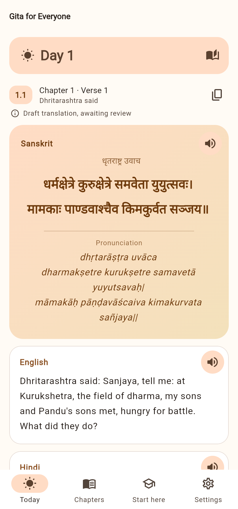
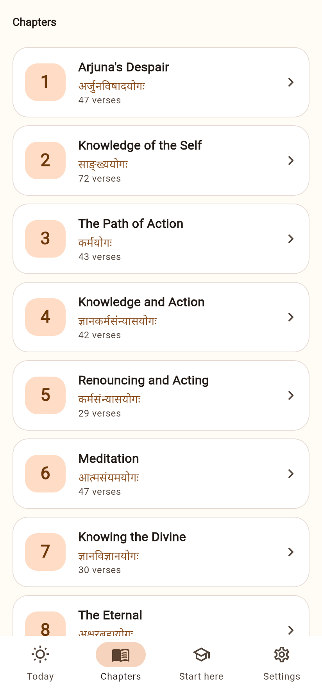
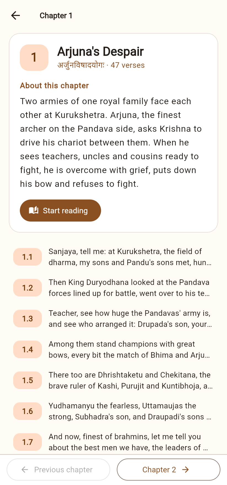
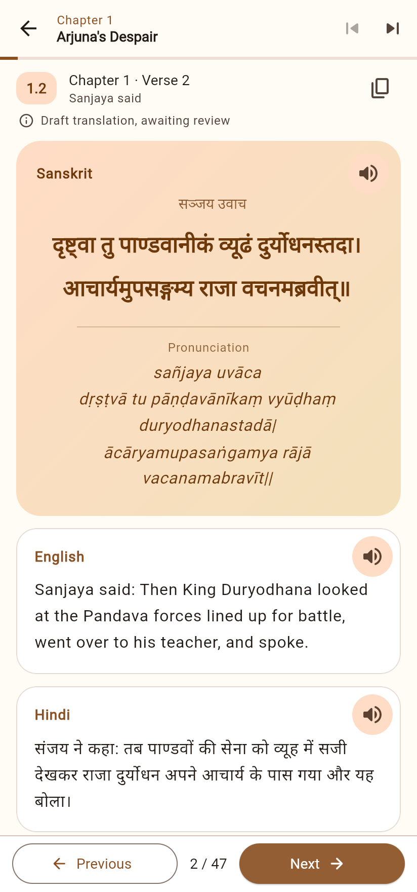

# UI layout

The app has four tabs (Today, Chapters, Start here, Settings) and one reader. Every
screen follows the same few rules so it feels calm and is easy for first-time readers.

| Today | Chapters | Chapter | Reader |
|---|---|---|---|
|  |  |  |  |

## Screens

**Today**: a "Day N" card at the top, with *Previous day* / *Back to today* and a
book icon that opens the same verse in the reader, so the reader can keep going.

**Chapters**: a *Continue reading* card (last verse opened) above 18 chapter cards.
Each card shows the number, the plain-language title, the Sanskrit name and the verse count.

**Chapter**: a header card (title, Sanskrit name, summary, *Start reading*), the verse
list with a short preview of each, and a bottom bar with **← Chapter N-1** and
**Chapter N+1 →**.

**Reader**: reads the whole Gita as one sequence.
- Top bar: chapter number and title, with **⏮ previous chapter** and **⏭ next chapter**.
  A thin progress bar shows how far through the chapter you are.
- Bottom bar: **← Previous**, the position (`12 / 47`) and **Next →**. On the last verse
  of a chapter, Next reads **Chapter N+1 →** and carries straight on. Swiping does the same.
- The last verse opened is saved, for *Continue reading*.

**Verse** (used by Today and the reader), from top to bottom:
1. Verse badge (`2.47`), "Chapter 2 · Verse 47", who is speaking, copy button.
2. A quiet draft notice while the translation is unreviewed.
3. Sanskrit card: Devanagari, a divider, then pronunciation. Listen button.
4. Translation cards, in the app's language first, each with its own Listen button.
5. "In simple words", in a differently coloured card.

## Design rules

- **One accent colour** (saffron, from the theme seed). Sanskrit is the warmest card,
  translations are white cards, and the simple meaning has its own colour.
- **Cards**: 20 px corners, no shadow, a thin outline.
- **Touch targets** of at least 48 px. Primary action filled, secondary outlined.
- **Text** at the phone's own size times the in-app size setting. Reading width is
  capped at 720 px on tablets.
- **Light and dark themes** come from the same colour scheme. Nothing is hard-coded
  except the light page background.
- Previous/next controls are always in the same place, at the bottom, within thumb reach.

## Ideas for later

- Bookmarks and a "favourites" list.
- Search by word or verse number.
- A one-tap "share as image" card for the daily verse.
- A reading streak and a gentle daily reminder notification (needs a permission prompt
  and a privacy-policy update).
- A bundled Devanagari font such as Noto Serif Devanagari (OFL licence), so Sanskrit
  looks the same on every phone.
